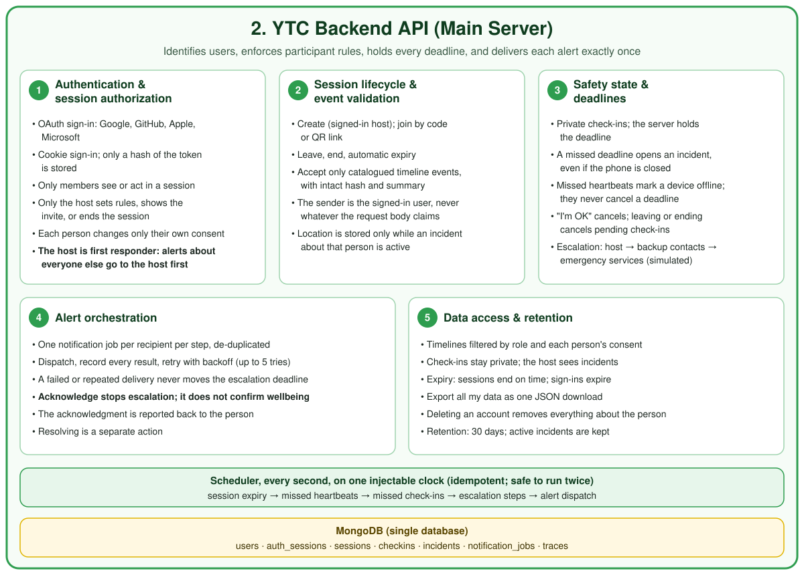

# YTC backend API

Box 2 of [`YTC Grand Architecture.png`](./YTC%20Grand%20Architecture.png), redrawn by responsibility:



Code: [`src/server/`](../src/server/). Tests: [`test/server/`](../test/server/). Pruning job: [`pipelines/`](../pipelines/).

| # | Responsibility | Folder |
| --- | --- | --- |
| 1 | Authentication and session authorization | `auth/` (`authz.ts` holds the participant rules; `ratelimit.ts`) |
| 2 | Session lifecycle and event validation | `lifecycle/` (sessions, ingestion, live location relay) |
| 3 | Safety state and deadlines | `safety/` |
| 4 | Alert orchestration | `alerts/` |
| 5 | Data access and retention | `data/` (timelines, Incident Card, export, deletion, retention) |
| 6 | Simulated voice-agent escalation (the agent itself is `src/agent/`) | `voice/` (`routes.ts`: `/api/calls`; `service.ts`: an external voice-agent service) |
| | The server's record of each session | `timeline/` (hash-chained, catalog format) |
| | Backup contacts with accounts | `contacts/` |

## Run it

```bash
cp .env.example .env      # fill in at least one sign-in provider
npm run server            # API on :8787, scheduler every second
npm run dev               # web app; /api is proxied to the API
```

Without `MONGODB_URI` the API uses an in-memory store and loses everything on restart.

## Endpoints

All bodies are JSON. Browser requests need the `ytc_session` cookie, and every write must come from `APP_ORIGIN`. `/api/service/*` uses a bearer token instead.

| Method and path | Who | What |
| --- | --- | --- |
| `GET /api/auth/providers` | anyone | Configured sign-in providers: Google, Apple, Microsoft |
| `GET /api/auth/:provider/start?returnTo=/path` | anyone | Redirect to the provider |
| `GET\|POST /api/auth/:provider/callback` | provider | Signs in; creates the account on first sign-in |
| `POST /api/auth/test/signin` | anyone on this computer | Development only: signs in as a made-up name, no password. Off unless `TEST_SIGN_IN=true`, the app and API origins are localhost, and `NODE_ENV` is not `production`; also refuses requests not addressed to localhost. `localhost` and `127.0.0.1` keep separate cookies, so they act as two phones. |
| `POST /api/auth/logout` | signed in | Ends this browser's sign-in |
| `POST /api/sessions` | signed in | Create a session; you are its host. Needs `consentTextVersion` and at least one complete `backupContacts` entry |
| `GET /api/sessions/join/:code` | signed in | Preview before joining |
| `POST /api/sessions/join` | signed in | Join with a code (typed or from the QR link `#join=CODE`). Needs `consentTextVersion` and at least one complete `backupContacts` entry; `joinedVia`: `code` or `qr`; optional `responderNote` reaches responders only if `consent.shareNoteWithResponders` is on |
| `GET /api/sessions/:id` | member | Session as you may see it |
| `GET /api/sessions/:id/invite` | host | Code, join link, QR as SVG |
| `PATCH /api/sessions/:id/rules` | host | Check-in, acknowledgment and heartbeat windows; size; location on/off |
| `PATCH /api/sessions/:id/me/consent` | member | Your own sharing, with `consentTextVersion` |
| `POST /api/sessions/:id/suspend` / `resume` | host | Pause or resume new check-ins, heartbeat checks and live location |
| `POST /api/sessions/:id/leave` | participant | Leave |
| `POST /api/sessions/:id/end` | host | End for everyone (not while an alert is open) |
| `POST /api/sessions/:id/me/backup-contacts/:contactId/invite` | member | Invite link for one of your backup contacts |
| `GET /api/contact-invites/:token` / `POST /api/contact-invites/accept` | signed in | A backup contact previews and accepts |
| `POST /api/ingest` | signed in | Store events, logs, actions, sensor and device data (see Ingestion) |
| `POST /api/sessions/:id/location` | member | Send your latest position for the group map (relayed, not stored) |
| `GET /api/sessions/:id/locations` | member | Positions you are allowed to see, labelled `live` or `stale` |
| `POST /api/sessions/:id/checkins` | member | Your device saw a movement change: start your check-in |
| `POST /api/checkins/:id/respond` | that person | `ok` cancels the deadline; `help` alerts now |
| `POST /api/sessions/:id/help` | member | Ask for help (the app confirms first) |
| `POST /api/sessions/:id/heartbeat` | member | Your device is alive |
| `POST /api/sessions/:id/update` | member | Add "I'm OK" to your open alert (logged only) |
| `GET /api/alerts` | signed in | Alerts delivered to you, exactly as delivered |
| `POST /api/alerts/:id/viewed` | recipient | You opened it (not an acknowledgment) |
| `POST /api/alerts/:id/acknowledge` | recipient | You are responding; escalation stops |
| `GET /api/incidents/:id` | subject, host, recipients | Full view for the host and the person; delivered facts only for other recipients |
| `GET /api/incidents/:id/card` | subject, host, recipients | The Incident Card, built from the timeline |
| `POST /api/incidents/:id/repeat` | responder | Re-send the current step (up to 2 times); the deadline does not move |
| `POST /api/incidents/:id/resolve` | responder | After acknowledging: `false_alarm`, `assistance_reached` or `other` |
| `GET /api/sessions/:id/timeline` | member | What you are permitted to see |
| `GET /api/sessions/:id/story` | member | What happened, in sentences, as you may see it: joins and leaves; alerts and their log (host and the person only); movements where a record of positions exists (the live incident demo's person, to whoever they share location with) |
| `GET /api/me` / `PATCH /api/me` | signed in | Profile: `displayName`, and `avatar` (PNG, JPEG or WebP data URL up to 100 KB, or `null` to remove) |
| `GET /api/me/export` | signed in | Everything about you, as JSON |
| `DELETE /api/me` | signed in | `{ "confirm": "DELETE" }` deletes your account and all your data |
| `GET /api/calls/capabilities` | anyone | Which models reason, listen and speak on simulated calls |
| `POST /api/calls` | anyone | Start a practice call to the mock operator about the built-in synthetic incident; returns the opening breakdown |
| `GET /api/calls/incoming` | signed-in session member | Calls the live demo's escalation placed that are still ringing |
| `POST /api/calls/:id/answer` | session member for live calls | Pick up a ringing call; the agent speaks the opening breakdown from that incident's record |
| `POST /api/sessions/:id/demo` | host | Demo mode only. `{ participantId }`: start the live incident demo (see below) |
| `GET /api/sessions/:id/demo` / `DELETE` | host | Demo mode only. Where the demo is; stop it (open alerts stay open) |
| `GET /api/calls/:id` | session member for live calls | Transcript, fact sheet and voice log |
| `POST /api/calls/:id/turns` / `.../speech` | session member for live calls | An operator turn; the console uses recorded speech (`audio_base64`, `mime_type`), while the typed route remains for internal and test compatibility |
| `POST /api/calls/:id/silence` / `.../interrupt` / `.../end` | session member for live calls | Silence, barge-in, hang up |
| `GET /api/calls/:id/turns/:n/audio` | session member for live calls | Speech (MP3) for an agent turn already in the timeline |
| `GET /api/service/incidents/:id/briefing` | voice-agent service | Consent-filtered operator briefing and evidence |
| `POST /api/service/incidents/:id/voice-events` | voice-agent service | Record one call event (`voice.*`) |
| `GET /api/internal/tick` | cron (`CRON_SECRET`) | Run one scheduler pass (serverless hosts) |

Practice calls use only synthetic data and can start without sign-in. Live
incident calls require a signed-in member of the session for discovery and
control. Each call spends Gemini and ElevenLabs quota; keep the server on
localhost or restrict access before exposing it. Details:
`docs/timeline.md`, "The live call".

## Rules worth knowing

- **Deadlines live on the server.** A closed or offline phone cannot stop a missed check-in from alerting the host. `test/server/safety.test.ts` proves this.
- **Exactly once.**
  - Each step is claimed with a compare-and-set before its alerts are queued.
  - Each job has a unique `dedupeKey`.
  - A worker must claim a job before sending it.
  - The store contract test checks all of this on MongoDB too.
- **Deadlines don't move.** The next step is due a fixed time after the current step was notified. Failed deliveries, retries, repeats, missed heartbeats and suspending the session never move or cancel it. The default path is the host for 60 seconds, then every eligible active group participant and the subject's backup contacts in parallel for 60 seconds, then simulated emergency services.
- **Acknowledgment stops escalation. It does not confirm wellbeing.** Resolving is a separate step.
- **Recipients see only what was delivered.** Each alert job freezes its message and the timeline events it is based on. A backup contact who was alerted sees only that, plus whether someone acknowledged or resolved. The host and the person the incident is about see the full incident.
- **Location is stored only during an active server incident.** Live group location is relayed in memory and never stored (see below).
- **Accounts are not merged by email**, because that would let an unverified address at one provider take over another account.
- **Nothing sensitive is kept.** No IP addresses, provider access tokens, raw session tokens or raw invite tokens are stored.

## The server timeline

Every session has one append-only, hash-chained timeline in the `src/timeline` catalog format, stored in `timeline_events`. The server records what it does:

- **Session and consent:** `session.*` events, and `consent.granted` and `consent.revoked` with the consent text version. This is the consent audit trail.
- **Check-ins:** `checkin.prompted`, `checkin.responded` and `checkin.missed`.
- **Incidents:** `incident.opened`, `incident.acknowledged` and `incident.resolved`.
- **Alerts and escalation:**
  - `notification.sent`, `notification.delivered`, `notification.viewed` and `notification.delivery_failed`
  - `escalation.step_scheduled`, `escalation.step_fired` and `escalation.step_cancelled`
  - `emergency.simulated_dispatch_requested`
- **Devices:** `connectivity.device_offline` and `connectivity.device_online`.
- **Location:** `location.reported`, during incidents only.
- **Voice calls:** `voice.*` events, sent by the voice-agent service.

Clients' own `sensor.*`, `profile.*` and (during an incident) `location.*` events are copied in after validation. Incidents and alerts are decided by the server only; client incident events are kept as a record, not acted on. The voice agent's briefing and the Incident Card are built from this timeline.

A help request with no pending check-in is recorded as a manual check-in answered "requested help", because the catalog requires every incident to point at an earlier event that triggered it.

**Account deletion** removes the person's events from sessions they only joined. The remaining chain is then rebuilt with the original ids and times, re-validated and re-hashed, so it still verifies. Sessions they hosted are deleted outright.

## Ingestion

`POST /api/ingest` takes up to 500 items:

- **Timeline events** (`kind: "event"`) must pass the catalog, their hash and their summary. Each is stored once per session and `event_id`, so an offline device can resend safely.
- **Other items** (`log`, `action`, `sensor`, `device`, `app`) must say where the data came from: `dataOrigin` is one of `live_device`, `recorded_dataset`, `synthetic_scenario` or `system_generated`.
- **Sensor items** also need `dataClass` (`raw` or `derived`) and `units`. Raw samples go to `raw_recordings`, apart from derived features (`CLAUDE.md`).
- **Resends:** send `clientItemId` with any item so a resend is stored once.
- **Location:** location-like keys are removed outside an active incident.

## Live group location

`CLAUDE.md` asks for consent-based group location visibility, while the backend rule is to store no location outside an incident. Both hold because live positions go through a relay (`src/server/lifecycle/relay.ts`) instead of the database.

- **Memory only.** The server keeps each participant's latest fix in memory. It never writes it to MongoDB, the traces collection, logs or the export.
- **Visibility follows consent.**
  - You always see yourself.
  - Everyone sees people who share with `group`.
  - The host also sees people who share with `host`, and people who share with responders during an incident.
  - Consent is checked again on every read.
- **Live, stale, gone.** A fix is shown as `live` for `locationStaleAfterSec` (90 s by default), then as `stale` (last known) until twice that, and after that it's forgotten.
- **Cleared at once** when someone turns sharing off, leaves, deletes their account, when the host ends, suspends or turns location off for the session, and when the session expires.
- **The only stored positions** are the person's fixes during an active incident, which are kept for responders, the timeline and the Incident Card.
- **Demo venue ("teleport").** The host may set `rules.demoVenue`, a public place such as a club, through `PATCH /api/sessions/:id/rules`. While it is set, every phone in the session relays a made-up position around it instead of its GPS, sent with `simulated: true` and returned that way to everyone, so it is never shown as a real location. Clearing it (`demoVenue: null`) drops those positions at once. The venue is the host's chosen public place, not anyone's position.
- **Limitation:** the relay lives in one process's memory. Running more than one API instance would need a shared in-memory cache with expiry (for example Redis TTL keys) instead.

## Live incident demo

A presenter tool for a short demo (`src/server/demo/`). It is mounted only
when `DEMO_INCIDENTS=true`, or with the localhost test sign-in. The host picks
a participant in Demo > Incident demo. That person must have turned on
movement check-ins themself; the demo refuses otherwise.

- **Inputs only.** It writes about 90 minutes of synthetic evening for that
  person (arriving, sitting, a phone left on a table and a check-in answered
  OK, dancing, walking), then, live, a hard impact about 5 s after the
  trigger and stillness. The samples go through the real `SensorPipeline`
  and detectors with 15 s windows.
- **The server does the rest.** When the detector fires, the server opens the
  person's private check-in (their phone shows it). If nobody answers, the
  scheduler opens the incident, alerts the host, then the group and backup
  contacts in parallel, then simulated emergency services, exactly as for any
  other incident. Starting the demo sets the session's windows to 20 s
  (check-in) and 30 s (each alert step), unvalidated values chosen to fit a
  short demo. The simulated operator call starts ringing at the same timestamp
  as the emergency step and still requires an explicit Accept action.
- **The call reads this incident.** The demo keeps the incident's timeline in
  memory: the synthetic history, the detections, and a mirror of the
  server's check-in, alerts, acknowledgment and resolution. When escalation
  reaches simulated emergency services, the voice agent places a call that
  rings on the operator console (`#operator`) until someone answers. The
  agent reads only that timeline; an acknowledgment, or the person's own
  "I'm OK" (`incident.participant_update`, stated as self-reported), reaches
  it within a second. The call's `activity` shows the agent's current step
  (reading the record, finding facts, drafting, checking, verifying) while
  it prepares an answer. The incident's log records that the call rang, was
  answered and ended.
- **Consent.** The call names the person and reads their note only if they
  turned on "Share my name and note" (`consent.shareNoteWithResponders`).
  Location is shared with the operator only under `shareLocationWithResponders`.
- **"What happened."** The person's synthetic movements in the demo record
  are told as sentences by `GET /api/sessions/:id/story`, to whoever they
  share location with. No other positions are stored, so nobody else's
  movements can be told.
- **Memory only**, like the location relay. Positions in the demo are
  synthetic, around the session's demo venue. Starting the demo sets the
  venue to Toronto City Hall if none is set, so every phone that shares
  location appears on the map, labelled simulated.

## Voice-agent service

Two pieces, for two set-ups. `/api/calls` (`voice/routes.ts`) runs the agent in this process, with a person at the operator console playing the mock operator; today it uses the synthetic no-response incident. `voice/service.ts` is for an external voice-agent service (the Django box in the architecture). Both read only from a timeline. Connecting `/api/calls` to real incidents from the server timeline is the natural next step.

When an incident reaches the simulated emergency step, the API posts to `${VOICE_AGENT_URL}/escalations`:

```json
{ "incidentId": "...", "sessionId": "...", "mockEndpointId": "mock-operator-local",
  "briefingPath": "/api/service/incidents/<id>/briefing",
  "voiceEventsPath": "/api/service/incidents/<id>/voice-events" }
```

The service then calls those paths with `Authorization: Bearer VOICE_AGENT_TOKEN`:

- **It reads the consent-filtered briefing**, which only exists for incidents that actually reached the emergency step.
- **It records each call turn** as a catalog `voice.*` event. Agent utterances must cite timeline events that exist, or they're refused.
- **Failed triggers are retried** like any other alert.
- **The operator console is voice-only.** Hold Space or the microphone button to speak; release sends the recording. The typed route is retained only for internal and test compatibility.

Without `VOICE_AGENT_URL` and `VOICE_AGENT_TOKEN`, the step is recorded as simulated and nothing is sent.

## Deploying

**Recommended:** run `npm run server` on a long-running Node 24 host, with MongoDB (for example MongoDB Atlas) and HTTPS. Point the web app's `/api` at it (same site, so the sign-in cookie works). The scheduler runs every second, so check-in deadlines and escalation fire on time.

**Vercel** (`vercel.json`, `api/index.js`, `npm run build:server`) works with limits:

- **Deadlines need something to tick.** There is no long-running scheduler. Set `TICK_ON_REQUEST=true` so a pass runs before API requests, and call `GET /api/internal/tick` with `Authorization: Bearer $CRON_SECRET` from a scheduler:
  - **Vercel Cron:** every minute on Pro, once a day on Hobby. It isn't in `vercel.json`, because a more frequent schedule fails deployment on Hobby.
  - **Another pinger:** any external scheduler that can call the URL.

  Deadlines are only noticed when a pass runs.
- **Memory is per instance.** The live location relay and the rate limits don't share state across instances.

## Environment variables

Set these on the API host. On Vercel: Project → Settings → Environment Variables, for Production and Preview. Never commit real values.

| Variable | Required | Value |
| --- | --- | --- |
| `APP_ORIGIN` | yes | The web app's origin, e.g. `https://your-app.vercel.app` |
| `API_ORIGIN` | yes | The API's public origin. Same as `APP_ORIGIN` on Vercel. Used for OAuth redirect URIs |
| `COOKIE_SECURE` | yes | `true` (HTTPS) |
| `MONGODB_URI` | yes | MongoDB connection string (secret) |
| `MONGODB_DB` | no | Database name, default `ytc` |
| `GOOGLE_CLIENT_ID`, `GOOGLE_CLIENT_SECRET` | per provider | Google OAuth client. Redirect URI: `<API_ORIGIN>/api/auth/google/callback` |
| `APPLE_CLIENT_ID`, `APPLE_TEAM_ID`, `APPLE_KEY_ID`, `APPLE_PRIVATE_KEY` | per provider | Sign in with Apple Services ID, team, key id, and the `.p8` key on one line with `\n` (secret). Redirect: `<API_ORIGIN>/api/auth/apple/callback` |
| `MICROSOFT_CLIENT_ID`, `MICROSOFT_CLIENT_SECRET`, `MICROSOFT_TENANT` | per provider | Entra ID app; tenant `common` for personal and work accounts. Redirect: `<API_ORIGIN>/api/auth/microsoft/callback` |
| `VOICE_AGENT_URL`, `VOICE_AGENT_TOKEN` | no | The voice-agent service's base URL and a long random shared secret |
| `CRON_SECRET` | Vercel | Long random secret for `/api/internal/tick` |
| `TICK_ON_REQUEST` | Vercel | `true` |
| `TRUST_PROXY` | Vercel | `true`, so rate limits see the client IP behind Vercel's proxy |
| `RETENTION_DAYS` | no | Default `30` |
| `RETENTION_IN_API` | no | `false` once the Python pruning job runs on a schedule |
| `GEMINI_API_KEY` | no | Simulated calls (`/api/calls`): the agent's reasoning. Without it, facts are read verbatim (secret) |
| `ELEVENLABS_API_KEY`, `ELEVENLABS_VOICE_ID` | no | Simulated calls: speech to text and text to speech (secret) |

## Pruning pipeline

`python -m pipelines.prune [--dry-run]` (needs `MONGODB_URI`, `pip install -r pipelines/requirements.txt`) applies the same retention rules as the API and prints one JSON line for monitoring. Run it daily from any scheduler, then set `RETENTION_IN_API=false`.

## Not built, on purpose or for now

- **Real push notifications.** `CLAUDE.md` says "Never … make real external notifications", and the event catalog's notification channels are simulated only (`in_app_sim`, `push_sim`). Alerts reach people through their YTC inbox. Adding push needs that rule changed first.
- **Real sign-in.** It hasn't been tried against Google, Apple or Microsoft. It needs registered apps and the variables above. Tests use a fake provider.
- **Simulated calls about real incidents.** `/api/calls` still uses the synthetic incident. The server timeline now has what it needs (`buildOperatorBriefing` works on it).
- **The external voice-agent service itself.** It's a separate Django service (box 4). This API triggers it and serves its data.
